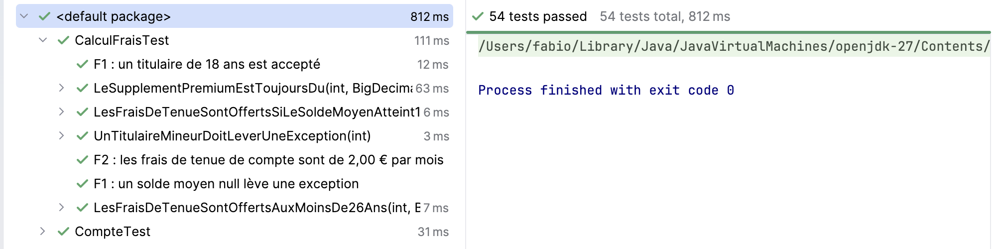
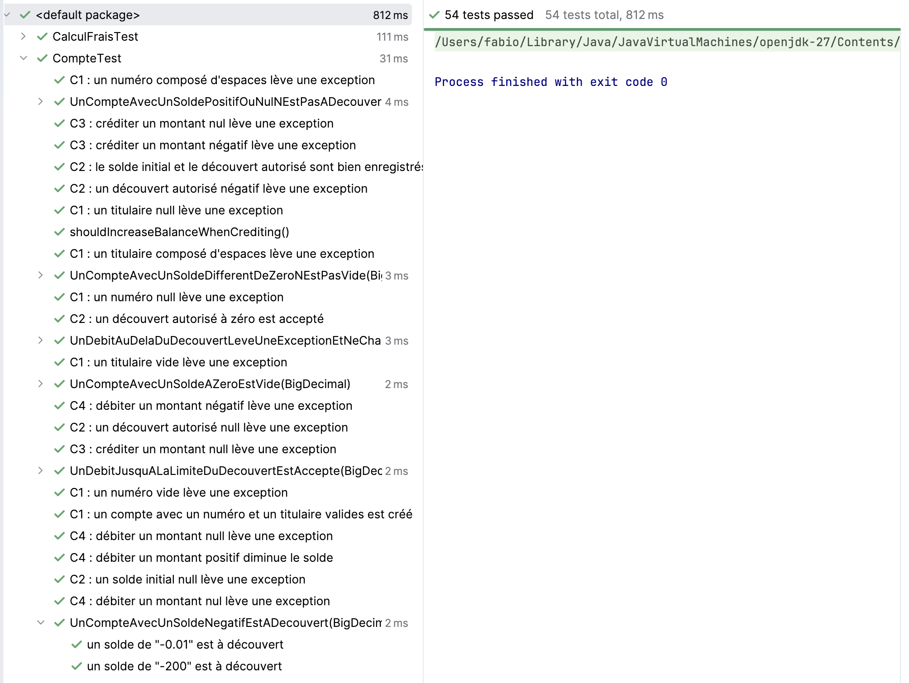
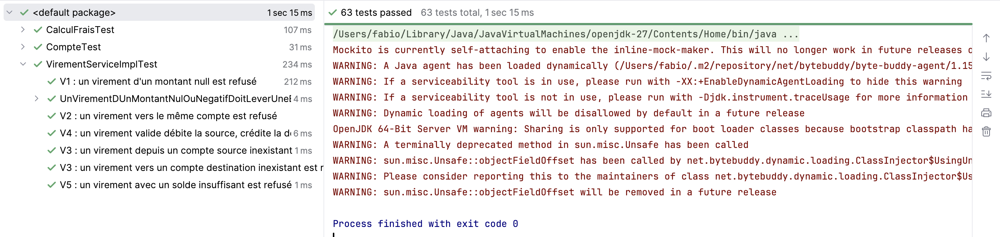

# Rendu : tests unitaires et TDD

SORU Fabio - ESGI Reims

# Partie A : défauts trouvés

C3 : `crediter` acceptait un montant nul. Test : `CrediterUnMontantNulDoitLeverUneException`

C5 : un débit qui atteint exactement la limite du découvert était refusé. Test : `UnDebitJusquALaLimiteDuDecouvertEstAccepte`

C6 : `estVide()` renvoyait faux pour un solde de 0.00. Test : `UnCompteAvecUnSoldeAZeroEstVide`

F3 : les frais de tenue étaient offerts à 26 ans. Test : `LesFraisDeTenueSontOffertsAuxMoinsDe26Ans`

F4 : les frais de tenue n'étaient pas offerts pour un solde moyen de 1000 €. Test : `LesFraisDeTenueSontOffertsSiLeSoldeMoyenAtteint1000Euros`

F5 : le supplément premium n'était pas compté quand la tenue était offerte. Test : `LeSupplementPremiumEstToujoursDu`

# Partie B : règles non terminées

V1 à V5 sont terminées, chacune avec un cycle rouge, vert, refactor dans l'historique git.

V5 : le test passait directement, car le vert de V4 débitait déjà la source avant de sauvegarder les comptes. Pour garder un cycle rouge, vert, refactor visible, j'ai forcé le rouge en inversant l'ordre dans `transferer` (sauvegardes avant le débit) : le test échouait alors avec `NeverWantedButInvoked`. Le vert a remis le débit avant les sauvegardes.

V6 : non faite (alerte au titulaire pour un virement strictement supérieur à 10 000 €). Elle était plus difficile car il faut vérifier l'appel à `NotificationService.alerter` avec le bon titulaire et le bon message, tester les deux valeurs limites (10 000 € sans alerte et 10 000,01 € avec alerte) et vérifier avec `never()` qu'aucune alerte n'est envoyée sinon.

V7 : non faite (refus des virements le dimanche avec `VirementRefuseException`). Elle était plus difficile car le service est créé dans le `@BeforeEach` avec une horloge fixée un vendredi : il faut une autre horloge fixée un dimanche pour ce test, créer une nouvelle exception et vérifier qu'aucun compte n'est sauvegardé.

# Couverture de code

## Partie A

## Partie B

