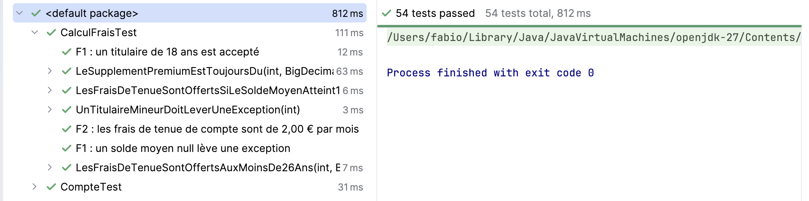
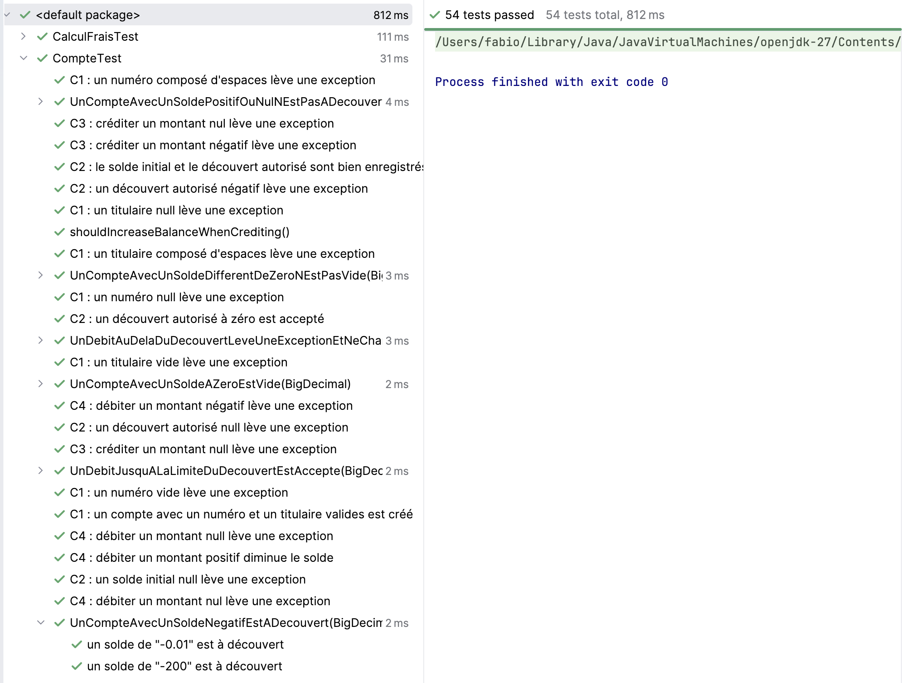

# Rendu : tests unitaires et TDD

SORU Fabio - ESGI Reims

## Partie A : défauts trouvés

C3 : `crediter` acceptait un montant nul. Test : `CrediterUnMontantNulDoitLeverUneException`

C5 : un débit qui atteint exactement la limite du découvert était refusé. Test : `UnDebitJusquALaLimiteDuDecouvertEstAccepte`

C6 : `estVide()` renvoyait faux pour un solde de 0.00. Test : `UnCompteAvecUnSoldeAZeroEstVide`

F3 : les frais de tenue étaient offerts à 26 ans. Test : `LesFraisDeTenueSontOffertsAuxMoinsDe26Ans`

F4 : les frais de tenue n'étaient pas offerts pour un solde moyen de 1000 €. Test : `LesFraisDeTenueSontOffertsSiLeSoldeMoyenAtteint1000Euros`

F5 : le supplément premium n'était pas compté quand la tenue était offerte. Test : `LeSupplementPremiumEstToujoursDu`

## Couverture de code

